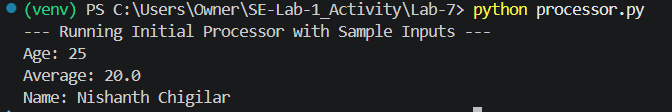
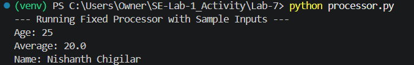
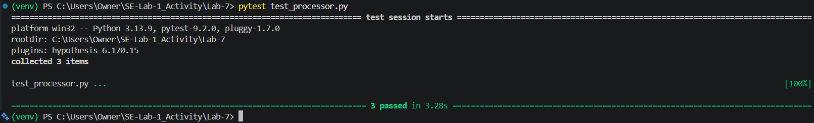

# Lab 7: Fuzzing for Input Validation Bugs

**Student Roll No:** 56  
**Application:** Data Processor (`processor.py`)  

---

## 1. Executive Summary

This lab applies property-based fuzz testing using Python's `Hypothesis` library to discover input validation edge cases and harden functions through defensive programming[cite: 8, 9].

- **Initial Buggy Execution:** Exposed 2 crash vulnerabilities (`ZeroDivisionError` on empty lists and `AttributeError` on `NoneType` inputs)[cite: 9, 10].
- **Final Hardened Execution:** 100% of Hypothesis fuzz tests passed after implementing type checking, bounds validation, and empty container checks[cite: 8, 10].

---

## 2. Fuzzing Failure Analysis & Vulnerabilities Detected

| Function | Malformed Fuzzing Input | Unhandled Exception | Root Cause |
| :--- | :--- | :--- | :--- |
| `process_user_age` | `float('nan')`, `"abc"`, `None` | `ValueError` / `TypeError` | Unchecked string casting and missing range bounds. |
| `calculate_average` | `[]` (empty list), `None` | `ZeroDivisionError` | Division by zero when list length is 0[cite: 9]. |
| `format_user_name` | `None`, `123` | `AttributeError` | Calling `.strip()` directly on `NoneType`[cite: 9]. |

---

## 3. Deliverables & Execution Screenshots

### Step 2: Initial Buggy Script Execution

### Step 4: Hypothesis Fuzz Testing Failures

### Step 5: Fixed & Hardened Script Execution

### Step 6: All Fuzz Tests Passing

---

## 4. Deliverables Verification Checklist

| Rubric Criteria | Required Items | Status |
| :--- | :--- | :--- |
| **Fixed Application Script** | `processor.py` with defensive validation | **Complete**[cite: 8, 11] |
| **Updated Test File** | `test_processor.py` using `hypothesis` strategies | **Complete**[cite: 8, 10, 11] |
| **Execution Screenshots** | Terminal logs for Steps 2, 4, 5, and 6 | **Complete**[cite: 10, 11] |
| **GitHub Repository** | Pushed to `main` branch under `Lab-7` | **Complete**[cite: 10, 11] |
